# Plan-to-PR code factory

[`plan-to-pr`](../skills/plan-to-pr/SKILL.md) is the factory coordinator. It
turns one approved software plan into tested, reviewed code and a draft pull
request, then hands the remaining judgment to a person.

The factory does not own product intent. Before `plan-to-pr` starts, a person
turns the business intent into a human-readable technical intent or plan,
prefers existing scaffolding where possible, and approves the scope. After the
handoff, a person uses the review surfaces to understand the generated code,
push back on specific segments, and decide readiness, merge, and release.

> [!IMPORTANT]
> `plan-to-pr` is the main pipeline. The other skills plug into its phases or
> support the manually orchestrated work around it; they do not replace the
> coordinator.

## The end-to-end workflow

```mermaid
flowchart TD
    NEED["Person: business intent<br/>or desired behavior change"]

    subgraph SHAPE["Meat proxy: shape technical intent"]
        VISUAL["visual-explanations<br/>make paths and tradeoffs readable"]
        REUSE["surgical-refactoring<br/>reuse existing scaffolding and contracts"]
        TECH["Human-readable technical intent<br/>assumptions, reuse, and open choices"]
    end

    NEED --> VISUAL --> TECH
    NEED --> REUSE --> TECH
    TECH --> TEACH{"Need a teaching pass?"}
    TEACH -->|Yes| WALK["Optional: plan-walkthrough-quiz"]
    TEACH -->|No| APPROVE["Person approves plan"]
    WALK --> APPROVE

    subgraph FACTORY["Current automated factory"]
        PLAN["plan-to-pr coordinator<br/>owns the complete pipeline"]
        INTAKE["1. Intake<br/>read plan, lock branch,<br/>resolve scope and settings"]
        REVIEW["2. Plan review<br/>invoke adversarial-review"]
        BUILD["3. Implement<br/>todos, tests, and commits"]
        GATEA["4. Gate A<br/>deterministic checks"]
        LOCAL["5. Local review<br/>invoke review-fix-loop"]
        GATEB["6. Gate B<br/>continue, report, or stop"]
        PR["7. Draft PR review<br/>invoke copilot-review-loop"]
        DESC["pr-descriptions<br/>expose decisions, risks,<br/>tradeoffs, and required steps"]
        HANDOFF["8. Handoff<br/>draft PR and decision packet"]

        PLAN --> INTAKE --> REVIEW --> BUILD
        BUILD --> GATEA --> LOCAL --> GATEB --> PR --> DESC --> HANDOFF
    end

    APPROVE --> PLAN

    subgraph REVIEWPR["Meat proxy: understand and judge the draft PR"]
        FLOW["code-flow-walkthrough<br/>trace generated-code intent by segment"]
        ANNOTATE["pr-annotations<br/>expose behavior impact<br/>and decision choices"]
        CHOICES["Decision choices exposed<br/>accept, adjust, defer, or enforce"]
        HUMAN{"Human reviewer:<br/>push back, defer,<br/>enforce, or accept?"}
    end

    HANDOFF --> FLOW --> HUMAN
    HANDOFF --> ANNOTATE --> CHOICES
    DESC -.-> CHOICES
    CHOICES --> HUMAN
    HUMAN -->|adjustment needed| REWORK["Manual revision<br/>to intent, plan, or code"]
    REWORK -.-> PLAN
    HUMAN -->|ready| MERGED["Person merges PR"]
    MERGED --> REFINE["Post-merge: refine-agent-guidance<br/>manual evidence-driven improvement"]

    click VISUAL href "skill-workflows/visual-explanations.md" "Open the visual-explanations workflow"
    click REUSE href "skill-workflows/surgical-refactoring.md" "Open the surgical-refactoring workflow"
    click WALK href "skill-workflows/plan-walkthrough-quiz.md" "Open the plan-walkthrough-quiz workflow"
    click PLAN href "../skills/plan-to-pr/SKILL.md" "Open the plan-to-pr skill source"
    click REVIEW href "skill-workflows/adversarial-review.md" "Open the adversarial-review workflow"
    click LOCAL href "skill-workflows/review-fix-loop.md" "Open the review-fix-loop workflow"
    click PR href "skill-workflows/copilot-review-loop.md" "Open the copilot-review-loop workflow"
    click DESC href "skill-workflows/pr-descriptions.md" "Open the pr-descriptions workflow"
    click FLOW href "skill-workflows/code-flow-walkthrough.md" "Open the code-flow-walkthrough workflow"
    click ANNOTATE href "skill-workflows/pr-annotations.md" "Open the pr-annotations workflow"
    click REFINE href "skill-workflows/refine-agent-guidance.md" "Open the refine-agent-guidance workflow"
```

Plan review and local hardening are delegation boundaries. Their own pages show
the branches and fix cycles used inside those calls.

Interactive runs can ask for a decision. Autopilot can record and continue with
small choices that stay inside the approved plan. A required scope or policy
change still stops or is reported, because it needs new approval.

## What each phase produces

| Phase | Output | Detailed skill flow |
| --- | --- | --- |
| 1. Intake | Goal, acceptance criteria, scope, settings, baseline, check commands, branch lock, and run state | This page |
| 2. Plan review | Call boundary and returned adjudication for the plan | Delegate to [Adversarial review](skill-workflows/adversarial-review.md) |
| 3. Implement | Code, tests, and explicit-path commits for each approved todo | [`plan-to-pr` source](../skills/plan-to-pr/SKILL.md#3-implement) |
| 4. Gate A | A green deterministic gate, counting confirmed baseline failures | [Review-fix loop](skill-workflows/review-fix-loop.md) |
| 5. Local review | Call boundary and returned loop result | Delegate to [Review-fix loop](skill-workflows/review-fix-loop.md) |
| 6. Gate B | Go, stop, or a list of valid leftovers and escalations passed to the PR | [`plan-to-pr` source](../skills/plan-to-pr/SKILL.md#6-gate-b) |
| 7. Draft PR review | Call boundary and returned draft-PR result | Delegate to [Copilot review loop](skill-workflows/copilot-review-loop.md) |
| 8. Handoff | PR link, phase status, unresolved decisions, settings, usage counts, and run directory | [`plan-to-pr` source](../skills/plan-to-pr/SKILL.md#8-handoff) |

## Synthetic factory handoff

Open the synthetic plan-to-PR handoff

> [!NOTE]
> The plan, commits, reviews, PR, and decisions below are fictional.

**Case:** Add idempotent usage posting to a billing ledger. Event `usage-731`
debits $60 from a $100 balance once. A repeated or concurrent request returns
the original entry and leaves the balance at $40.

| Factory phase | Human-readable outcome |
| --- | --- |
| Intake | Goal, $100-to-$40 scenario, no double charge, scope, checks, and non-goals recorded. |
| Plan review | One concurrency finding became a required fix. Fractional-cent rounding was escalated. |
| Build and Gate A | Preview stayed read-only; focused and full checks passed. |
| Local review | One fix cycle repaired a preview persistence leak and simplified duplicate entry construction; the confirmation review found no fix items. |
| PR review | One Copilot review cycle fixed conflict-result mapping and deferred balance caching. |
| Handoff | Draft PR remains open; the final push's review was requested but not awaited. |

**Needs human judgment**

1. Which rule rounds a fractional cent into the ledger amount?
2. May a usage debit take the account below zero?
3. When is the remaining draft PR review evidence enough to make the PR ready?

The handoff links the implementation, tests, and detailed skill reports without
repeating their internal workflows.

## Meat proxy steps around `plan-to-pr`

These are the meat proxy's steps around the observed workflow. `plan-to-pr`
does not invoke all of them.

| When | Meat proxy step and purpose |
| --- | --- |
| Before the implementation plan | [Visual explanations](skill-workflows/visual-explanations.md) makes the intended code paths, branches, outputs, and tradeoffs visible. [Surgical refactoring](skill-workflows/surgical-refactoring.md) checks how much existing scaffolding can be reused instead of rebuilding a wheel. Together they produce technical intent that human reviewers can read, challenge, and adjust before implementation details are planned. |
| Before approval | [Plan walkthrough and quiz](skill-workflows/plan-walkthrough-quiz.md) can turn the technical intent into a code-verified teaching sequence. [Code flow walkthrough](skill-workflows/code-flow-walkthrough.md) and [Visual explanations](skill-workflows/visual-explanations.md) can fill a specific evidence gap. |
| Draft PR communication | [Pull request descriptions](skill-workflows/pr-descriptions.md) is delegated by [Copilot review loop](skill-workflows/copilot-review-loop.md) to expose the PR's decisions, open risks, tradeoffs, and required human steps in a scan-friendly body. |
| After the draft PR and handoff | [Code flow walkthrough](skill-workflows/code-flow-walkthrough.md) traces one real scenario through the generated code so a person can understand the implementation's intent and request adjustments in a specific segment. [Pull request annotations](skill-workflows/pr-annotations.md) exposes the behavior-changing choices and hardening concerns at changed locations. Together with the PR description, it gives the meat proxy explicit choices: accept, adjust, defer, or enforce. |
| After merge | [Refine agent guidance](skill-workflows/refine-agent-guidance.md) is manually dispatched against this repository with repeated gaps or decisions that felt improvable. It produces bounded, evidence-based guidance proposals. True recursive self-improvement (RSI) is a potential next step, not current behavior. |

In this workflow, "meat proxy" means a human reviewer or decision maker. These
steps make the intent, generated implementation, and judgment points easier to
inspect and challenge.

## Current boundaries and improvement areas

The pipeline is intentionally bounded. It optimizes for safe forward progress,
not unlimited autonomous work.

| Area | Current boundary or improvement area |
| --- | --- |
| Intent | A person still defines product intent, scope, plan, and initial approval. |
| Environment | Missing credentials, unavailable tooling, and unsupported repository state can block intake or checks. |
| Decisions | In-scope choices can continue on autopilot when they are recorded. Scope and policy changes still require a new decision. |
| Generated-code comprehension | A post-draft walkthrough is currently manual. The walkthrough helps locate segment-level disagreement, but `plan-to-pr` does not automatically turn that feedback into a new implementation pass. |
| Review limits | Valid work can remain when a fix-cycle cap is reached. The factory needs a durable queue for unfinished work. |
| Concurrency | Human review, another push, a no-longer-draft PR, or a conflict causes a stop or handoff. Safe reconciliation and resume remain an improvement area. |
| Delivery | The final review after the last push is not awaited. Readiness, merge, deployment, and rollback remain manual. |
| Improvement | Post-merge learning is manual today. `refine-agent-guidance` requires bounded trials and evidence before changes are accepted; guidance publication still requires separate authorization. A true RSI loop is a major future improvement area. |

> [!NOTE]
> The post-merge feedback loop is not autonomous RSI. It begins with human
> observations, uses controlled evidence, and does not publish or self-modify
> guidance without the required authorization.
