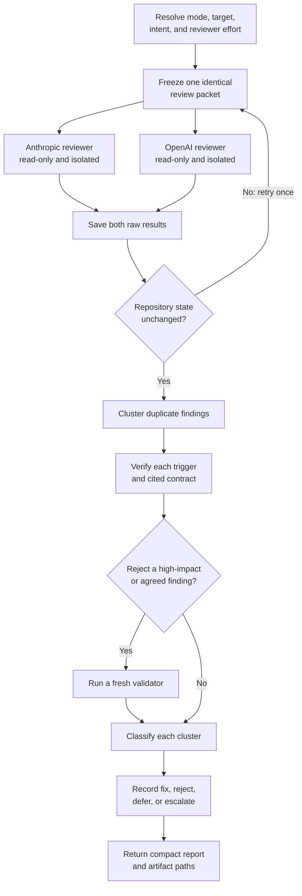

# Adversarial review

[Back to the code factory map](../skill-workflows.md) |
[Canonical skill source](../../skills/adversarial-review/SKILL.md)

This skill supplies independent review at the plan, local-change, and
Copilot-finding stages of the factory.

**Use it when:** a change, plan, question, or external findings need an
independent second opinion.

**Result:** verified finding dispositions: fix, reject, defer, or escalate.

If both reviewer slots fail after retry, the round is a review failure, not a
clean review. Reviewer output is treated as a hypothesis until the parent
verifies it.

## Synthetic example output

Open the synthetic adversarial-review report

> [!NOTE]
> This example is fictional. It shows the report shape, not repository evidence.

**Case:** A draft change posts a $60 usage charge to a billing ledger. A retry
with the same usage event ID must return the original ledger entry and leave the
balance unchanged at $40 from an opening balance of $100.

**Compact review report**

- **Mode:** `change`
- **Target:** `base...head` at synthetic SHA `abc1234`
- **Reviewers:** Claude Opus, xhigh; GPT-6.2 Astra, xhigh
- **Verdicts:** Slot A found one blocking issue; Slot B found the same issue
  and one scope question.

| ID | Finding | Verification | Disposition |
| --- | --- | --- | --- |
| R1.1 | Two concurrent requests can both read "not posted" and append a $60 debit. | A synthetic two-transaction reproduction creates two entries for one event ID. The insert has no unique-key protection. | **fix** — P1 |
| R1.2 | A $10.005 charge can round to a different cent total in preview and final posting. | Both paths call the same calculator, but the plan does not define the rounding rule. | **escalate** — needs a product decision |
| R1.3 | Cache the account balance to reduce reads. | Caching can improve throughput later, but the current defect and approved scope do not require it. | **defer** — follow up after load evidence |

**Human decision:** Which rounding rule must turn a fractional cent into a
ledger amount? The synthetic change must not choose a billing policy silently.

