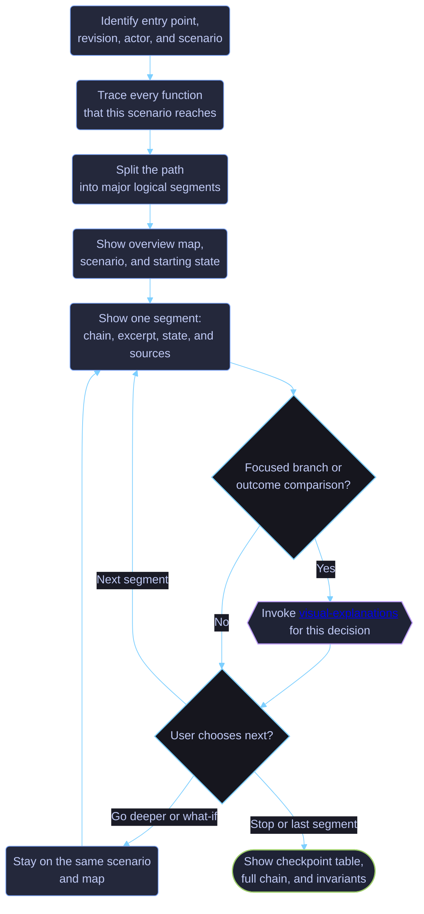

# Code flow walkthrough

[Back to the code factory map](../skill-workflows.md) |
[Canonical skill source](../../skills/code-flow-walkthrough/SKILL.md)

This skill supports the factory when a person needs to understand the system
before approving a plan or a code decision.

**Use it when:** the user wants to learn one code flow over several turns.

**Result:** one scenario carried from entry point to final state, with a recap.

> [!WARNING]
> Mermaid links in this diagram are pinned to `main` because GitHub cannot
> resolve document-relative node links inside its Mermaid iframe. A new target
> can return 404 before merge; use the relative Markdown links below the
> diagram for same-ref navigation.



For a focused branch or output comparison, use
[`visual-explanations`](visual-explanations.md) instead of a multi-turn
walkthrough. This page does not redraw the delegated visual flow.

## Synthetic walkthrough segment

<details>
<summary>Open the synthetic billing-ledger walkthrough</summary>

**Synthetic example:** The scenario, functions, source excerpts, and state are
fictional.

**Scenario:** In a billing ledger, account `acct-9` starts with a $100 credit.
The worker receives usage event `usage-731` for a $60 charge. The same event
arrives again after a worker retry.

### 2. `BillingService.post_usage_charge`: post once or return the original

**You are here**

```text
BillingWorker.handle
  -> BillingService.post_usage_charge  ◀ you are here
       -> Ledger.find_by_event_id
       -> Ledger.append_entry
       -> Account.update_balance
```

```python
# In BillingService.post_usage_charge (synthetic)
entry = ledger.find_by_event_id(account_id, usage_event_id)
if entry:
    return entry

entry = ledger.append_entry(
    account_id=account_id,
    usage_event_id=usage_event_id,
    amount=-money(60, 0),
)
return entry
```

For the first delivery, `find_by_event_id` returns no row. The service appends
one `-$60` entry. For the retry, the lookup returns that same entry, so the
write path is not entered.

| State | Before | After first delivery | After retry |
| --- | ---: | ---: | ---: |
| Account balance | $100 | $40 | $40 |
| Ledger entry for `usage-731` | Not present | `entry-204`, debit $60 | Same `entry-204` |
| New writes | - | 1 ledger entry | 0 |

This keeps the account from being charged twice for one usage event. The
next walkthrough segment would examine the concurrent-request conflict path,
where both workers observe the event as missing before either transaction
finishes.

</details>
