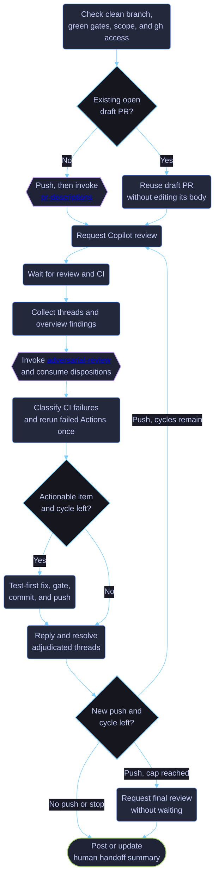

# Copilot review loop

[Back to the code factory map](../skill-workflows.md) |
[Canonical skill source](../../skills/copilot-review-loop/SKILL.md)

This skill is the factory's draft-PR review stage. It makes external review
progress visible, then stops when human or concurrent work needs ownership.

**Use it when:** the current branch should be reviewed through a draft PR, or
`plan-to-pr` reaches the PR phase.

**Result:** an iterated draft PR and a summary for human reviewers.

The loop stops for a person review, another push, a no-longer-draft PR, a head
conflict, or a request failure. It never marks the PR ready or merges it.

## Delegated skill flows

| When | Delegate to | Return used by this loop |
| --- | --- | --- |
| A new draft PR needs a body | [Pull request descriptions](pr-descriptions.md) | A scan-friendly body that preserves this loop's required facts and markers |
| Copilot findings need judgment | [Adversarial review](adversarial-review.md) | Fix, reject, defer, or escalate dispositions |

The fix commit follows the explicit-path, test-first, and ledger rules from the
[review-fix loop](review-fix-loop.md), but this page does not redraw that loop.

## Synthetic example output

Open the synthetic Copilot review handoff

**Synthetic example:** The PR, review, CI result, and URLs below are fictional.

**Draft PR handoff comment**

**Case:** The billing ledger draft PR posts one $60 debit for `usage-731`.

**Status:** The draft completed one Copilot review cycle and is ready for human
judgment.

| Review item | Disposition | Human-facing result |
| --- | --- | --- |
| C1.1 | Fixed | A unique-key conflict now reloads and returns the original entry instead of surfacing a database error. |
| C1.2 | Rejected | Reusing the posting adapter from invoice preview would change a read-only path. Focused tests show preview must stay write-free. |
| C1.3 | Deferred | A cached ledger balance remains a follow-up because there is no load evidence for it. |

**CI:** green. One failed run passed after a single rerun and was recorded as a
flake.

**Needs human judgment**

1. Which rule should round a fractional cent into a ledger amount?
2. May a posted usage charge take the ledger below zero, or must it reject?

**Final revision:** A review was requested after the last push but was not
awaited. The PR stays draft and is not marked ready or merged.

