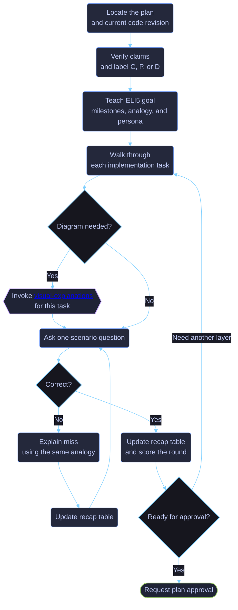

# Plan walkthrough and quiz

[Back to the code factory map](../skill-workflows.md) |
[Canonical skill source](../../skills/plan-walkthrough-quiz/SKILL.md)

This skill closes the plan-understanding gap before the approved plan enters
the factory.

**Use it when:** the user needs to understand a plan before approval.

**Result:** a code-verified teaching sequence and a recap table in the plan.

> [!WARNING]
> Mermaid links in this diagram are pinned to `main` because GitHub cannot
> resolve document-relative node links inside its Mermaid iframe. A new target
> can return 404 before merge; use the relative Markdown links below the
> diagram for same-ref navigation.

The workflow can update the plan or session artifact. It does not change code,
push, or assume approval.

When a task walkthrough needs a diagram, it follows
[Visual explanations](visual-explanations.md) rather than duplicating that
flow here.

## Synthetic teaching excerpt

Open the synthetic plan walkthrough and quiz

**Synthetic example:** This plan, code names, and quiz are fictional.

**Goal**

Post each usage event to the billing ledger once, even when a worker retries or
two workers receive the same event. A $60 charge moves an account from $100 to
$40 and never to -$20 for a duplicate delivery.

**One analogy**

Treat the usage event ID like a stamped receipt number. The first cashier
stamps the receipt and records the debit. A later cashier with the same receipt
number returns the original record instead of charging the account again.

| Piece | Problem it solves | What breaks without it |
| --- | --- | --- |
| Event key | Identifies a retried event. | The same charge looks new. |
| Unique ledger constraint | Lets the transaction reject a concurrent duplicate. | Two workers can both debit. |
| Conflict reload | Converts the losing request into a retry result. | The losing worker sees an unexplained database error. |
| Preview boundary | Keeps invoice preview read-only. | A preview can move money. |

**Persona story**

Account `acct-9` has $100 available. Event `usage-731` charges $60. The first
request appends one entry and leaves $40. The worker retries after it loses the
response. The second request finds the same entry, returns it, and makes no
new debit.

**One-question quiz**

> Two workers process `usage-731` at the same time. Worker A and Worker B both
> finish their first lookup before either commits. What must happen?

The correct answer is: one transaction commits the uniquely keyed entry; the
other receives a conflict, reloads that entry, and returns it without a second
debit. Both callers can receive a successful result, but only one write
reaches the ledger.

| # | Question | Canonical answer |
| --- | --- | --- |
| 1 | Two workers post the same event concurrently | One unique entry commits; the loser reloads it; the balance changes once. |

