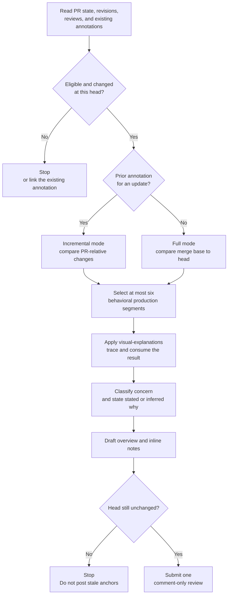

# Pull request annotations

[Back to the code factory map](../skill-workflows.md) |
[Canonical skill source](../../skills/pr-annotations/SKILL.md)

This optional stage reduces the manual review burden after the factory has
produced a PR.

**Use it when:** a reviewer needs an explanation of the main behavior changes in
a large or generated PR.

**Result:** one comment-only review with an overview and a few inline notes.



Annotations explain control flow, changed outcomes, and review focus. They do
not find defects, approve, block, or replace human review.

## Delegated trace flow

Segment tracing follows [Visual explanations](visual-explanations.md). This
page keeps the annotation eligibility, selection, concern, anchoring, and
submission flow; it does not repeat the delegated trace procedure.

## Synthetic example annotation

<details>
<summary>Open the synthetic pull request annotation</summary>

> [!NOTE]
> The code locations, intent quote, and behavior below are fictional.

**Case:** A billing ledger posts usage event `usage-731` and changes an account
balance from $100 to $40. A repeated or concurrent request must return the
original entry.

### Annotation

**1. Idempotent usage debit** - Concern: **High**: a missed uniqueness
guard can charge the same event more than once.

**Why:** Stated (synthetic plan): "A usage event must create at most one
ledger debit, even when the worker retries."

**Control flow** (before -> after)
```text
Before: load account -> append $60 debit
After:  find event key
        +-- exists -> return original entry
        +-- missing -> append under unique event key
                         +-- conflict -> reload original entry
```

| Input / state | Before | After |
| --- | --- | --- |
| Fresh `usage-731` | Append one $60 debit; balance becomes $40. | Same visible result, now inside an event-keyed transaction. |
| Duplicate `usage-731` | A second debit could reach $20. | Return the original entry; balance stays $40. |
| Two concurrent requests | Both may append. | One append wins; the other reloads the winning entry. |

**Review focus:** Confirm the unique key includes `account_id` and
`usage_event_id`, and confirm a transaction conflict cannot change the balance
before the original entry is reloaded.

<sub>Evidence: synthetic before and after; tests: concurrent post and duplicate
post (illustrative, not run)</sub>

This is an explanatory review, not an approval or defect verdict.

</details>
