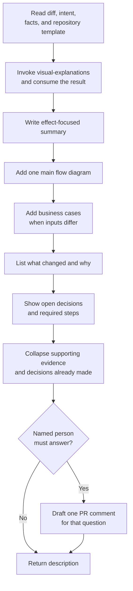
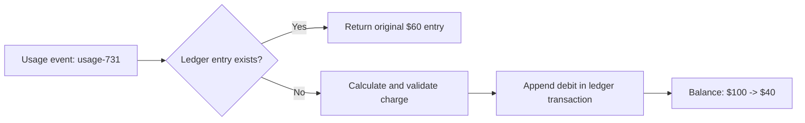

# Pull request descriptions

[Back to the code factory map](../skill-workflows.md) |
[Canonical skill source](../../skills/pr-descriptions/SKILL.md)

This skill turns factory evidence into a PR body that a person can scan before
making the final decision.

**Use it when:** a PR body must be written or restructured.

**Result:** a scannable description with visible decisions and collapsed
supporting detail.

Writing a description does not authorize posting it. `copilot-review-loop`
supplies the PR facts and the hidden marker; this skill decides where they go.

## Delegated visual flow

[`visual-explanations`](visual-explanations.md) owns the diagram, table, and
alert decisions. This skill owns only the PR layout and visibility rules, so it
does not redraw that flow here.

## Synthetic example output

Open the synthetic pull request body

> [!NOTE]
> The PR body below is fictional and demonstrates structure only.

The billing ledger now posts one $60 debit for each usage event. Repeated or
concurrent delivery of the same event ID returns the original entry without a
second balance change.

### What changed and why

- `UsageChargeWorker` reuses the existing charge calculator and ledger
  transaction.
- A unique `(account_id, usage_event_id)` key protects concurrent retries.
- Invoice preview returns the calculated amount without posting it.
- A duplicate event returns the original entry and keeps the balance at $40.

### Needs human judgment

| Decision | Why it matters | Current PR behavior |
| --- | --- | --- |
| Fractional-cent rounding | Different rules can change the invoice total. | Keep the existing calculator pending a policy decision. |
| Negative balances | It changes credit and collections behavior. | Reject the post under the existing rule. |

### Testing

- Unit: fresh post, duplicate event, concurrent retry, and preview
- Local: format, lint, type check, full unit suite
- PR: Copilot review and CI completed

In a real PR, longer evidence, accepted decisions, and test output would move
into named collapsed sections. Questions for a named person would go in a PR
comment, not the body.

