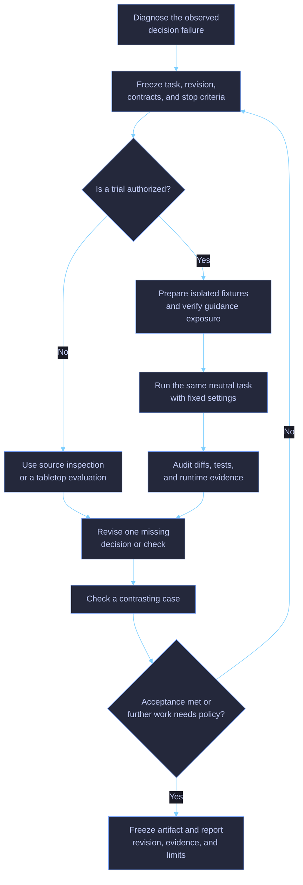

# Refine agent guidance

[Back to the code factory map](../skill-workflows.md) |
[Canonical skill source](../../skills/refine-agent-guidance/SKILL.md)

This skill improves the factory itself after a repeated decision failure. It
keeps evaluation narrow and separates guidance quality from model or fixture
changes.

**Use it when:** a skill or instruction file repeatedly causes an observed
decision failure.

**Result:** a narrow guidance change with explicit evidence and limits.

Guidance authoring does not authorize agent trials, publication, or production
changes.

## Synthetic refinement handoff

Open the synthetic guidance-refinement handoff

> [!NOTE]
> The trial, observed failure, and guidance revision below are fictional.

**Observed problem in the synthetic billing ledger**

A repeated guidance pattern said, "Remove wrappers and share the smallest
common helper." In two isolated trials, that pattern moved
`appendLedgerEntry` into the shared invoice-preview path. Preview began to write
a $60 debit, although the contract said only the worker may persist it.

**Frozen evaluation contract**

- Invoice preview may calculate a $60 charge, but may not write or schedule
  work.
- The billing worker posts one debit for `usage-731`.
- A repeated event returns the original entry and keeps the balance at $40.
- A contrasting safe case may still consolidate code when both callers have
  the same persistence contract.

**Result**

| Revision | Outcome |
| --- | --- |
| Baseline guidance | Two trials consolidated the persistence boundary incorrectly. One produced a shared helper that could write from preview. |
| Candidate guidance | Both trials compared entry-point side effects before proposing consolidation. Both kept a pure calculation core and reused the existing ledger transaction only in the worker. |
| Contrasting case | The candidate still permitted consolidation when two caller paths had the same write contract. |

**Narrow guidance change**

Require a caller-by-caller side-effect table before recommending wrapper
removal. A helper may be shared only after each entry point's writes, external
calls, error mapping, and forbidden work are shown.

**Evidence limits**

- Synthetic tabletop and two-trial illustration; not a benchmark.
- No claim that this revision improves every task.
- Guidance was drafted, not published.
- The accepted contract and any production release still require separate
  human approval.

