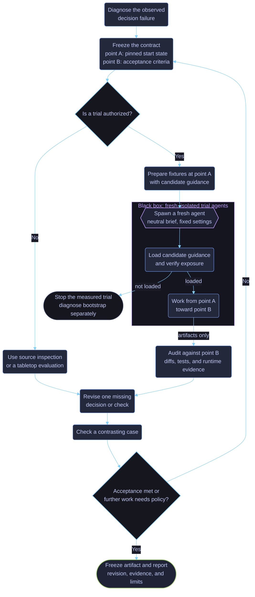

# Refine agent guidance

[Back to the code factory map](../skill-workflows.md) |
[Canonical skill source](../../skills/refine-agent-guidance/SKILL.md)

This skill improves the factory itself after a repeated decision failure. It
keeps evaluation narrow and separates guidance quality from model or fixture
changes.

**Use it when:** a skill or instruction file repeatedly causes an observed
decision failure.

**Result:** a narrow guidance change with explicit evidence and limits.

The coordinator first freezes two points. Point A is the start state: the
pinned task, source revision, and setup. Point B is the target: the acceptance
criteria and the forbidden side effects. When a trial is authorized, the
coordinator gives the candidate guidance to new, isolated trial agents. Each
agent starts at point A and works toward point B. The trial checks whether a
fresh agent with the candidate guidance reaches point B without help from the
coordinator.

> [!IMPORTANT]
> Trial agents are black boxes. Each agent gets only the point A fixture, the
> candidate guidance, and a neutral task brief. The coordinator judges its
> diffs, tests, and runtime evidence, not its own report.

## What keeps a trial blind

- **New context:** each measured trial uses a new session. A reused or resumed
  session keeps its earlier context, so its result is formative and not blind.
- **Point A only:** the agent works in a trial-owned fixture at the pinned
  revision. The fixture has no prior reports, logs, or files from other trials.
- **Neutral brief:** the brief gives the task, invariants, and approved
  changes. It does not give the diagnosis, the expected design, earlier
  results, or coaching.
- **Real guidance exposure:** the agent must load the candidate guidance
  through the host's supported mechanism. If the guidance does not load, the
  run is a bootstrap failure, not evidence about guidance quality.
- **Same conditions:** every revision gets the same brief, models, settings,
  and validation commands, so the guidance revision is the only intended
  difference.
- **Stateful coordinator:** the coordinator remembers every round and revises
  the guidance. The trial agents remember nothing between rounds.

> [!NOTE]
> Fresh sessions and trial-owned fixtures make the isolation. Instructions
> alone do not. Shared tools or storage can still leak information, so the
> report records each isolation limit.

Guidance authoring does not authorize agent trials, publication, or production
changes.

## Synthetic refinement handoff

Open the synthetic guidance-refinement handoff

**Synthetic example:** The trial, observed failure, and guidance revision below
are fictional.

**Observed problem in the synthetic billing ledger**

A repeated guidance pattern said, "Remove wrappers and share the smallest
common helper." In two isolated trials, that pattern moved
`appendLedgerEntry` into the shared invoice-preview path. Preview began to write
a $60 debit, although the contract said only the worker may persist it.

**Frozen evaluation contract (point B)**

- Invoice preview may calculate a $60 charge, but may not write or schedule
  work.
- The billing worker posts one debit for `usage-731`.
- A repeated event returns the original entry and keeps the balance at $40.
- A contrasting safe case may still consolidate code when both callers have
  the same persistence contract.

**Trial setup (point A)**

Each guidance revision got two new trial agents. Each agent started in its own
copy of the pinned billing-ledger revision, loaded the guidance under test, and
received only this brief: "Remove duplicated charge logic between invoice
preview and the billing worker. Keep the listed invariants. Add tests." No
agent saw the diagnosis, the other trials, or the expected design.

**Result**

| Revision | Outcome |
| --- | --- |
| Baseline guidance | Two trials consolidated the persistence boundary incorrectly. One produced a shared helper that could write from preview. |
| Candidate guidance | Both trials compared entry-point side effects before proposing consolidation. Both kept a pure calculation core and reused the existing ledger transaction only in the worker. |
| Contrasting case | The candidate still permitted consolidation when two caller paths had the same write contract. |

**Narrow guidance change**

Require a caller-by-caller side-effect table before recommending wrapper
removal. A helper may be shared only after each entry point's writes, external
calls, error mapping, and forbidden work are shown.

**Evidence limits**

- Synthetic tabletop and two-trial illustration; not a benchmark.
- No claim that this revision improves every task.
- Guidance was drafted, not published.
- The accepted contract and any production release still require separate
  human approval.

