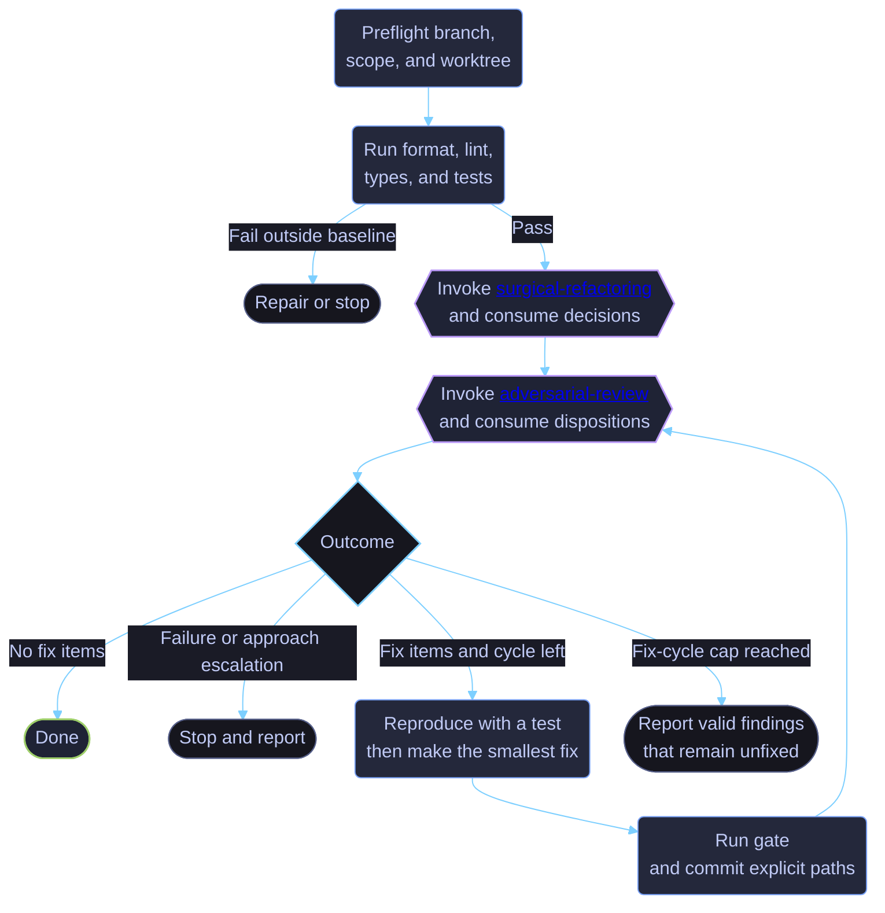

# Review-fix loop

[Back to the code factory map](../skill-workflows.md) |
[Canonical skill source](../../skills/review-fix-loop/SKILL.md)

This skill is the factory's local quality gate. It reduces the cost of later
PR fixes and records any valid work that remains at the cycle cap.

**Use it when:** a local code change needs deterministic checks, simplification,
review, and bounded fixes before a PR.

**Result:** clean, capped, escalated, or failed local review state.

Every fix is followed by a fresh review. The simplification pass runs once,
before the initial adversarial review.

## Delegated skill flows

This page stops at each delegation boundary. The delegated page owns the
internal decisions for that call.

| When | Delegate to | Return used by this loop |
| --- | --- | --- |
| Simplification | [Surgical refactoring](surgical-refactoring.md) | Apply, keep, or needs-approval candidates |
| Initial and confirmation reviews | [Adversarial review](adversarial-review.md) | Fix, reject, defer, or escalate dispositions |

## Synthetic example output

Open the synthetic review-fix-loop handoff

**Synthetic example:** The commands, commit, and findings below are fictional.

**Case:** A billing ledger worker posts a $60 usage charge exactly once for event
`usage-731`. The opening balance is $100; the retry must keep the balance at
$40.

**Local loop handoff**

- **Result:** clean
- **Gate:** format, lint, type check, and unit tests passed
- **Simplify:** one option wrapper was removed; separate caller error mapping
  was kept
- **Reviews:** 2 dual-model rounds at xhigh
- **Fix cycles:** 1

| Finding | Before fix | Result |
| --- | --- | --- |
| L1.1 | The invoice preview called the same adapter as the final posting path and could persist a debit. | Split the preview from persistence while reusing the existing amount calculator and ledger entry builder. |
| L1.2 | A duplicate charge constructor existed in preview and worker code. | Reused the private entry builder while preserving the worker-only transaction boundary. |

**Commit:** `abc1234 Address review findings (cycle 1)`

**Fresh confirmation review:** no fix items
**Needs human judgment:** define the rounding rule for a fractional cent

