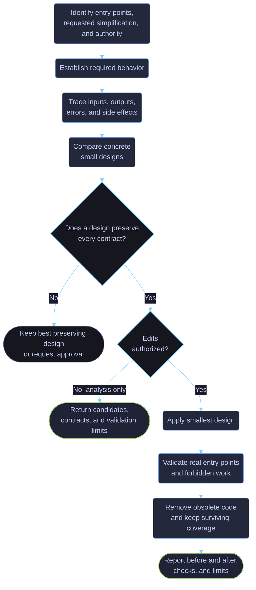

# Surgical refactoring

[Back to the code factory map](../skill-workflows.md) |
[Canonical skill source](../../skills/surgical-refactoring/SKILL.md)

This skill runs during the local simplify pass when the factory needs a smaller
design before external review.

**Use it when:** duplicate logic, helpers, wrappers, or an API shape needs a
smaller design without a contract change.

**Result:** a behavior-preserving design, or a request for approval when policy
must change.



The workflow prefers evidence over line counts or wrapper counts. It keeps
caller-specific behavior, error mapping, and side-effect boundaries.

## Synthetic example output

<details>
<summary>Open the synthetic refactoring recommendation</summary>

**Synthetic example:** This design recommendation and its code names are
fictional.

**Case:** In a billing ledger, invoice preview and a worker both calculate a $60 usage
charge. Only the worker may post the charge to the ledger. The two paths
duplicate amount calculation and ledger-entry construction.

**Chosen alternative**

```text
Before (each path duplicates calculation and entry construction):
preview -> inline charge math -> inline entry build -> return amount
worker  -> inline charge math -> inline entry build -> appendLedgerEntry()

After (existing calculator, one private builder, separate side effects):
preview -> charge calculator -> private entry builder -> return amount, no write
worker  -> charge calculator -> private entry builder -> appendLedgerEntry()
```

| Contract | Before | After |
| --- | --- | --- |
| Fresh event | Worker appends a $60 debit. | Same result through the existing ledger transaction. |
| Duplicate event | Worker returns the original entry. | Same result; the caller does not write twice. |
| Preview | Preview returns a calculated $60 amount. | Same result, with no ledger read cache or write side effect added. |
| Insufficient funds | Existing policy rejects the post. | Same policy remains at the worker boundary. |

**Why this design:** It reuses the existing calculator and
`appendLedgerEntry` transaction. It removes duplicate entry construction
without moving persistence into preview. A smaller-looking design is rejected
if it requires a public `preview` mode or changes either caller's policy.

**Validation limits:** Synthetic focused tests cover both entry points. A real
change would still verify the ledger transaction, unique event key, currency,
rounding boundary, and existing rollback behavior.

</details>
