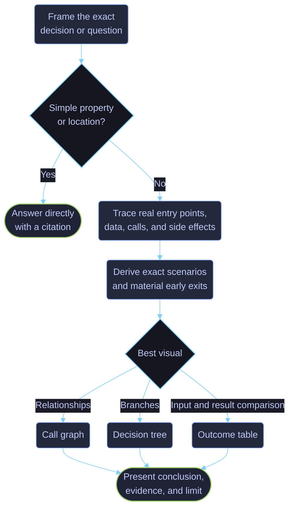

# Visual explanations

[Back to the code factory map](../skill-workflows.md) |
[Canonical skill source](../../skills/visual-explanations/SKILL.md)

This skill supplies the compact diagrams, tables, and decisions that support
factory explanations and PR communication.

**Use it when:** one decision, call path, branch, or outcome comparison needs a
compact explanation.

**Result:** a verified conclusion with only the diagram or table that helps.



This skill is read-only unless another authorized task explicitly permits
implementation or posting.

For a pull request description, this skill owns the visual form only.
[Pull request descriptions](pr-descriptions.md) owns the summary order,
visible decisions, collapsed support, and posting boundary. Refer to that page
instead of duplicating the PR layout here.

## Synthetic example

<details>
<summary>Open the synthetic decision and outcome visual</summary>

**Synthetic example:** This billing ledger scenario is fictional. It
demonstrates the visual, not production behavior.

**Synthetic conclusion:** A duplicate event must return the original ledger
entry and perform no new write. The idempotency lookup and the unique event key
must protect the same write transaction.

```text
post(usage-731)
    |
    +-- entry exists -> return original entry
    |                   no write; balance stays $40
    |
    +-- no entry -> check policy
                      |
                      +-- rejected -> policy error
                      |               no write; balance stays $100
                      |
                      +-- allowed -> append $60 debit under unique event key
                                       |
                                       +-- conflict -> return winner's entry
                                       |               no second write; $40
                                       |
                                       +-- no conflict -> commit
                                                          balance $100 -> $40
```

| Input state | Result | New ledger write | Final balance |
| --- | --- | ---: | ---: |
| Fresh event, $100 balance | Charge $60 | 1 | $40 |
| Same event retried after success | Return original entry | 0 | $40 |
| Same event posted concurrently twice | One charge; losing request reloads it | 1 total | $40 |
| Invoice preview | Return calculated amount | 0 | $100 |
| Existing policy rejects insufficient funds | Return policy error | 0 | $100 |

The graph shows control flow. The table shows the observable outcomes. Neither
states that the behavior exists until source and tests verify it.

</details>
